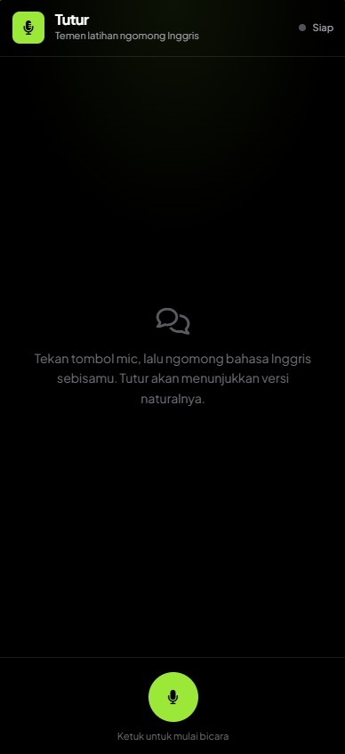
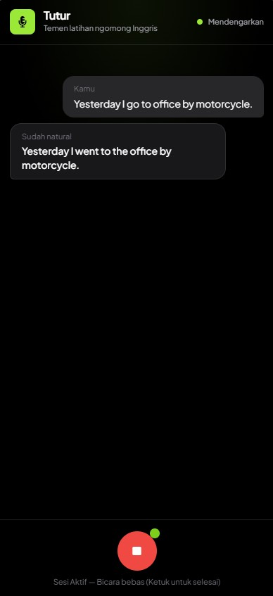

# Tutur: Real-Time AI Speech Recasting Companion

Tutur is a privacy-first, zero-latency AI speech recasting web application designed for non-native English learners. Built to help users practice spoken English without fear or judgment, Tutur listens to incoming real-time audio streams, transcribes spoken phrases, and instantly reformulates them into natural, fluent native expressions while preserving the user's original intent and tone.

Powered by a FastAPI backend integrated with FastRTC for WebRTC audio handling, the system utilizes Silero VAD for intelligent pause detection. Spoken audio is processed on-the-fly via Groq's high-speed API—leveraging Whisper Large v3 Turbo for Speech-to-Text and GPT OSS 20B for real-time sentence recasting. The frontend is built as a reactive Single Page Application (SPA) using Alpine.js and Tailwind CSS, communicating over WebRTC data channels for instant live feed updates.

## Application Screenshots

| Screen | Description | Preview |
| :--- | :--- | :--- |
| **Idle Companion Workspace** | The minimalist initial state displaying session status indicators, microphone trigger, and usage guidance. |  |
| **Live Recast Session** | Real-time interactive session feed showing speech-to-text transcriptions ("You") alongside native reformulations ("Versi natural") as you speak. |  |

## System Features

- **Real-Time WebRTC Audio Streaming**: High-throughput, send-only audio streaming over WebRTC paired with server-side Silero Voice Activity Detection (VAD) that triggers recasting upon natural pauses.
- **Dual-Stage Groq AI Pipeline**: Ultra-fast Speech-to-Text using `whisper-large-v3-turbo` combined with `openai/gpt-oss-20b` for instant grammar, tense, and collocation reformulations.
- **Dynamic ICE/TURN Credential Management**: Automated background renewal and serving of short-lived TURN/STUN credentials to guarantee seamless WebRTC NAT/firewall traversal.
- **Zero-Storage & Privacy-First**: Audio buffer arrays are converted to PCM in-memory on demand; no raw audio files, transcriptions, or user sessions are ever stored on disk.
- **Reactive Stream UI**: Lightweight Alpine.js SPA with auto-scrolling conversation feed, connection state management, and real-time visual distinction for already-natural phrasing.

## Technical Specifications

- **Backend Framework**: FastAPI (Python)
- **Real-Time Streaming Engine**: FastRTC (`fastrtc`) over WebRTC
- **Voice Activity Detection**: Silero VAD (`SileroVadOptions` & `ReplyOnPause`)
- **Speech-to-Text (STT)**: Whisper Large v3 Turbo (`whisper-large-v3-turbo` via Groq Async API)
- **Language Model (LLM)**: GPT OSS 20B (`openai/gpt-oss-20b` via Groq)
- **Network Traversal**: Dynamic STUN/TURN Relay Server Management
- **Frontend Architecture**: Single Page Application (Alpine.js / Tailwind CSS / FontAwesome)
- **Audio Processing Engine**: NumPy, Wave, In-Memory BytesIO
- **License**: MIT License

## License

This project is licensed under the MIT License - see the `LICENSE` file for details.